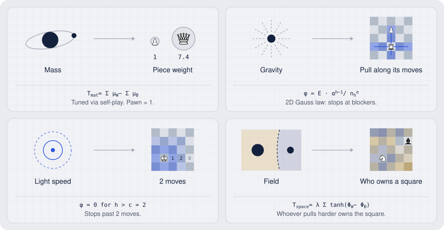
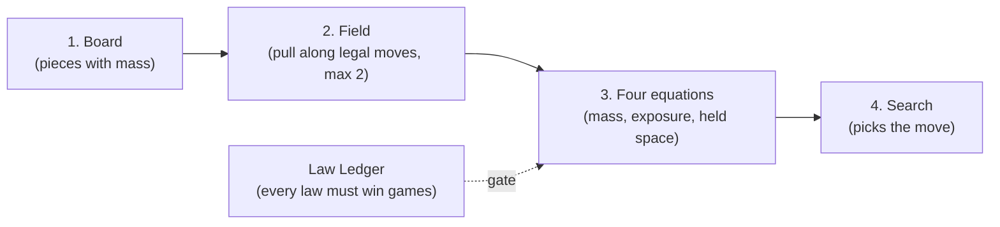

<div align="center">

# Kepler-64

### An experiment in playing chess using four physics equations built for a 2D board and ten numbers.

**[Play it in your browser](https://kepler.ripuranjan.com)** · [The idea](#the-idea) · [What nobody wrote down](#what-nobody-wrote-down) · [What it found](#what-it-found) · [The equations](#the-equations) · [Open problems](#open-problems)

</div>

Richard Feynman once compared physics to watching a game of chess without knowing the rules: watch long enough and you slowly work out the laws underneath.

Kepler-64 runs that the other way round. It knows the rules of chess but has never been told how to play: no strategy, no opening book, no human games, no neural network. What it has instead is a small physical world laid over the 64 squares. Pieces have mass. Their pull travels only along the lines they can legally move, stops at the first piece in the way, spreads thin over the squares it reaches, and never arrives if it needs more than two moves to get there.

The experiment asks whether that physics, and nothing else, can tell a good position from a bad one well enough to play chess. So far the answer is yes: with the search held identical, the physics beats plain material counting by **+330 Elo over 4,000 games**. The evidence is [below](#does-it-work).

## The idea

**Version 0 took the laws of the universe literally.** Newton's gravity by straight-line distance, a tidal tensor, a Roche limit, even gravitational waves, all computed on the 64 squares as if they were points in space. It played chess, and the straight-line pull of pieces around each king really did steer its moves. But an [audit](docs/v1/01_V0_AUDIT.md) showed that the tidal tensor, the Roche limit and gravitational waves never changed a single move in 120 test positions. Straight-line distance cannot see that a bishop is walled in by its own pawns, or that a knight jumps.

**So v1 re-derived the laws for the board.** Each law keeps what it says in physics, and swaps ordinary space for the space chess actually has, where distance is counted in **moves**:

| Law | What it says in space | Re-derived for a chessboard |
|---|---|---|
| **Gauss's law** | A source's flux spreads over the sphere around it, so pull falls off as $1/r^2$ | A piece's pull spreads over the shell of squares it can reach in $h$ moves: divide by $n_h^\sigma$ ($\sigma = 1$ is exact flux conservation) |
| **Speed of light** | Influence only arrives inside the light cone | Pull only arrives within $c$ moves, and stops at the first piece in its way |
| **Potential energy** | A body in a field has energy $U = m\Phi$ | A piece's exposure is its mass times (enemy pull − friendly pull) |
| **Roche limit** | A moon breaks up when tidal pull beats its own gravity | A king's 3×3 body "breaks" when enemy pull beats friendly support *(built, tested, and cut)* |

To these the board adds one law of its own, **held space**: each square belongs to whichever side pulls on it harder. In practice:

- A rook's pull runs down an open file in a single step, because a rook crosses the whole file in one move. A knight's pull lands in an L. A pawn pulls only on the squares it could capture.
- Pull stops at the first piece in its way, with no x-rays, so a bishop behind its own pawns is cut off from the far side of the board.
- Pull on your own piece is support, and pull on an enemy piece is attack. Both are the same field.
- Pull that needs more than two moves to arrive never arrives. That limit, `c = 2`, is the board's speed of light.

<picture>
  <source media="(prefers-color-scheme: dark)" srcset="docs/v1/assets/physics-plate-dark.svg" />
  <source media="(prefers-color-scheme: light)" srcset="docs/v1/assets/physics-plate-light.svg" />
  
</picture>

From that one field the engine reads three things: how much mass each side has, how exposed each piece is, and which side holds each of the 64 squares. A standard lookahead search, which knows only the rules (legal moves, checkmate, stalemate, draws), looks a few moves ahead and uses those readings to choose. That is the whole program.



**Every law then has to pass a gate.** It plays thousands of games against a copy of the engine without it, and stays only if it makes the engine stronger. That gate is the [Law Ledger](#the-law-ledger), and so far it has cut three laws: the Roche limit, tidal load, and accretion (captured mass making a piece heavier). Self-play also tunes ten constants inside the laws (the masses, how fast pull fades, how thinly it spreads) so that nobody has to hand-pick them. That is the full extent of the learning.

The four equations are 151 lines of Rust in [`laws/mod.rs`](engine/crates/kepler-core/src/laws/mod.rs). The move-distance geometry they read (how far each piece's pull reaches and where it is blocked) is in [`field.rs`](engine/crates/kepler-core/src/laws/field.rs).

## What nobody wrote down

The evaluation is the four equations and nothing more; the spec rules out any hand-written chess knowledge ([`02_LAWS_SPEC.md`](docs/v1/02_LAWS_SPEC.md) §9). Yet several familiar ideas of chess strategy turn up by themselves, as quantities of the one field:

| Chess idea | Where it turns up in the physics |
|---|---|
| Mobility | A piece with open lines reaches more squares, so it pulls on more of the board |
| Control of space and the centre | Held space: each square belongs softly to whichever side pulls harder on it |
| Defended and hanging pieces | Binding energy: a piece with more enemy pull on it than friendly support is exposed |
| Hemmed-in pieces, closed positions | Pull stops at the first blocker, so a boxed-in piece pulls on very little |
| Piece values | Masses tuned by self-play. In two runs that started them all equal, they sorted themselves into the human order ([below](#piece-values-from-an-equal-start)) |
| King safety | Still open. Two king laws were tried, and the Ledger cut both ([open problem 1](#open-problems)) |

This table says where those ideas live in the equations. It does not claim the engine weighs them the way a strong player would.

## What it found

### Piece values, from an equal start

Two control runs started the knight, bishop, rook and queen at the same mass, 4.43 each, and let self-play move them (30 rounds × 2,000 games at depth 4). The runs used different seeds and played different games from the first round on. Both landed in the same place:

| | Knight | Bishop | Rook | Queen |
|---|---|---|---|---|
| Start | 4.43 | 4.43 | 4.43 | 4.43 |
| Run A | 2.65 | 3.30 | 4.44 | 8.23 |
| Run B | 2.63 | 3.28 | 4.43 | 8.23 |
| As multiples of the knight | 1 | 1.25 | 1.68 | 3.11 (A), 3.12 (B) |
| Traditional 3 / 3 / 5 / 9, same scale | 1 | 1 | 1.67 | 3 |

The order queen > rook > bishop > knight came out of self-play alone, and the rook and queen land close to the traditional ratios. These are the weights these laws need, so they make no claim about "true" piece values. Evidence: [run A](engine/results/control-equal-masses-a/), [run B](engine/results/control-equal-masses-b/) (findings F20, F24 in [`09_FINDINGS.md`](docs/v1/09_FINDINGS.md)).

### Which laws survived

Every law has to earn its place in the [Law Ledger](#the-law-ledger). Each one is switched off (or on) in a copy of the engine, and the two copies play 4,000 games.

- **Kept:** the field as a whole (+330 Elo over counting material), spreading pull thin over the squares it reaches (+129), and held space (+111).
- **Light speed:** two moves beat three (+14), and one move tied two. Pull that needs three moves to arrive made the engine weaker.
- **Came back:** binding energy was cut at Gen 1 (−15) and earned its place back at Gen 3 (+35).
- **Rejected:** the most literal astrophysics. Accretion, where a piece grows heavier by capturing, cost 103 Elo. Two designs for a king torn apart by tidal pull, a Roche limit and a tidal load, did not make it stronger. In both equal-mass runs, training pushed the Roche limit's weight to zero by itself, before any ablation was run. (In the main line of generations, later training grew it back, and it still makes no measurable difference.)

### Does it work?

- **Same search, physics against material.** Against the *identical* search counting material alone, the physics scores **87%** (`3,313 W / 334 D / 353 L`, **+330 Elo** [+316, +345] at depth 4 over 4,000 games; [`ledger-gen001.md`](engine/results/ledger-gen001.md)).
- **It holds at equal time.** Material-only skips the field, so it searches deeper in the same time. Untrained Gen 0 with the equations still scores **68.8%** at 100 ms per move (**+137 Elo** over 200 games; [`m1-gate.md`](engine/results/m1-gate.md)).
- **Against Stockfish.** Gen 3, the previous champion, scored **53%** over 200 games against Stockfish 19 limited to its `UCI_Elo` 2100 setting, at 30 seconds plus 0.3 per move. `UCI_Elo` is Stockfish's own strength scale, separate from human ratings ([full ladder](#against-stockfish)).
- **Against its own first version.** At equal depth, v1's untrained Gen 0 beat v0 **100 games to 0** ([why there is a v1](#why-there-is-a-v1)).

## The equations

Everything the evaluator computes fits on one screen (the full spec is in [`docs/v1/02_LAWS_SPEC.md`](docs/v1/02_LAWS_SPEC.md)):

### 1. The field of a piece (Gauss's law + light speed)

$$
\varphi_p(s) = \begin{cases}
\dfrac{E_p \cdot \alpha^{h_p(s)-1}}{n_{h_p(s)}(p)^{\sigma}} & \text{if } h_p(s) \le c \cr
0 & \text{if } h_p(s) > c
\end{cases}
$$

- **$E_p$** is the piece's weight (in pawns). A king has no material weight, so its pull is its own constant, $\kappa$.
- **$h_p(s)$** is the distance to square $s$ counted in moves along legal lines, stopping at the first blocker (no x-rays). Beyond the light-speed limit **$c = 2$ moves**, the pull never arrives.
- **$\alpha$** is how much pull survives each extra move of travel.
- **$n_h(p)$** is how many squares sit at move-distance $h$. Dividing by $n_h^\sigma$ is the board version of **Gauss's law**: just as gravity in 3D spreads thin over the surface of a sphere ($1/r^2$), a piece's pull spreads thin over the squares it reaches ($\sigma = 1$ conserves total flux; the engine settled near $0.58$).

Each side's total field on square $s$ is simply the sum of its pieces:

$$
\Phi_W(s) = \sum_{p \in W} \varphi_p(s), \qquad \Phi_B(s) = \sum_{p \in B} \varphi_p(s)
$$

### 2. Rest mass

$$
T_{\text{mat}} = \sum_{p \in W \text{, } t \neq K} \mu(t_p) - \sum_{p \in B \text{, } t \neq K} \mu(t_p)
$$

Total weight on the board, in **Kepler units** (`1 ku` = one pawn). Kings have no material weight: they are bodies to protect or mate.

### 3. Binding energy

$$
e_q = M_q \cdot \big(\Phi_{\text{enemy}}(s_q) - \Phi_{\text{own}}(s_q)\big), \qquad T_{\text{bind}} = \lambda_{\text{bind}} (U_B - U_W)
$$

Mass times net field: the potential energy of a body sitting in an external field. When the enemy pulls on a piece harder than its own side supports it, $e_q$ turns positive and the piece is unbound, or exposed. $U_W$ and $U_B$ sum $e_q$ over each side's non-king pieces.

### 4. Held space

$$
T_{\text{space}} = \lambda_{\text{space}} \sum_{s=0}^{63} \tanh\big(\Phi_W(s) - \Phi_B(s)\big)
$$

Each of the 64 squares belongs softly to whichever side pulls harder on it.

### Total score

$$
\text{Score} = T_{\text{mat}} + T_{\text{bind}} + T_{\text{space}} + T_{\text{roche}} + T_{\text{tide}}
$$

That is the entire evaluation. The last two terms, a **Roche limit** (enemy pull tearing apart a king's 3×3 body when stress $\tau_K$ overwhelms its own support $b_K$) and **tidal load**, are real equations in the engine too, and so is **accretion** (captures absorbing a fraction of the victim's mass). When tested, none of them made the engine stronger, so in the champion they sit at zero or at no measurable effect, and they remain playable as alternate universes.

## Ten numbers

Self-play does tune Kepler-64, so the learned part deserves an exact size. It is the constants inside the hand-written equations, and that is all. A neural-network chess engine stores tens of millions of weights. Kepler-64's spec defines **15 constants** in total ([`params.rs`](engine/crates/kepler-core/src/params.rs)). In the current champion (**Home**, Gen 4, [`gen-004.json`](engine/data/generations/gen-004.json)), **10 of them carry the measured effect**: nine decimals and one integer (`c = 2`), about **40 bytes** in total. Three more, the Roche limit's, are still switched on but make no measurable difference, and the last two are at zero. You could set the whole evaluation by hand with sliders.

| Constant | Value in Home | Role | Status |
|---|---|---|---|
| `m_n`, `m_b`, `m_r`, `m_q` | `2.7`, `3.1`, `4.2`, `7.4` | piece weights (pawn = `1`, fixed) | Active |
| `kappa` | `2.63` | how hard the king itself pulls | Active |
| `alpha` | `0.54` | pull kept per extra move of travel | Active |
| `sigma` | `0.58` | flux spreading over reached squares (0 = none, 1 = conserved) | Active |
| `c` | `2` | light speed: max moves pull can travel | Active |
| `lambda_space` | `0.126` | weight of held space | Active |
| `lambda_bind` | `0.019` | weight of binding energy (exposure) | Active |
| `beta`, `rho`, `k_roche` | `2.75`, `1.56`, `3.34` | Roche limit on the king | No measurable effect (−6 [−16, +4] Elo) |
| `f_acc` | `0` | accretion (captures absorbing mass) | Off (rejected) |
| `lambda_tide` | `0` | tidal load on the king | Off (rejected) |

Self-play games do two jobs, and only the second is learning:
1. **The gate.** Each law is switched off in one copy of the engine and left on in another, and the two play thousands of games. A sequential test (SPRT) decides whether the law stays. Nothing is learned here; it is a measurement.
2. **Tuning.** `TDLeaf(λ)` adjusts the ten constants from the engine's own games, so they are measured instead of hand-picked.

## The universes

A **universe** here means one set of laws together with its constants. Change a law or a constant and you get a different universe, which plays differently. Rejected laws are not deleted, and every universe below is playable in the [browser](https://kepler.ripuranjan.com):

| Universe | What's different there |
|---|---|
| **Home** | The current champion (Gen 4). The strongest so far. |
| **Genesis** | Every piece was born the same weight, and found its own value by playing itself. |
| **First Light** | Before any self-play: human piece values, laws set by hand. |
| **Hunger** | Captures absorb weight: a piece grows by eating. Home played better without it. |
| **Roche** | A king can be torn apart by enemy pull, like a moon too close to its planet. Neither version made it stronger. |
| **Undertow** | Enemy pull drags on the king's whole body. It made the engine weaker. |

Hunger, Roche, and Undertow are Home with one law switched back on. They were never re-trained that way, so they show what the law does, not how strong a universe built around it could be.

## Why there is a v1

The audit of v0 ([`docs/v1/01_V0_AUDIT.md`](docs/v1/01_V0_AUDIT.md)) measured how often removing each term changed v0's chosen move, over 120 positions. The straight-line force around each king changed it in 22.5% (enemy king) and 25.8% (own king) of positions, and material in 17.5%. The tidal tensor, the Roche limit, binding energy and gravitational waves changed it in none. v0 (Python and JAX) is kept frozen in [`kepler64/`](kepler64/) as the baseline.

v1 was rebuilt from scratch in Rust around the re-derived laws above. At equal depth, its untrained Gen 0 beat v0 **100 games to 0** ([`m1-v1gen000-vs-v0-d3.json`](engine/results/m1-v1gen000-vs-v0-d3.json)).

## How this was built

Kepler-64 is a solo project by someone whose world is space and astronomy, not machine learning or engine development. It was built with AI as a core tool, openly: most of the code was written with Claude (Anthropic) as the coding assistant, the way a growing share of software and research is written today. The concept, the laws, the experiments, and every decision about what stays, what gets cut, and what may be claimed are the author's.

That is also why everything here is checkable rather than taken on trust. Every number on this page comes from a committed result file, the laws are written out in full in [`docs/v1/02_LAWS_SPEC.md`](docs/v1/02_LAWS_SPEC.md), and every experiment can be rerun.

## The details

Everything below is for engine developers and the curious. Every number links to the file it comes from.

<details>
<summary><b>Against Stockfish</b></summary>

<a id="against-stockfish"></a>

Gen 3 against Stockfish 19 with `UCI_LimitStrength` at each `UCI_Elo` setting, 30 s + 0.3 s per move, 200 games per rung (100 openings, both colours). Source: [`engine/results/ladder-gen003.json`](engine/results/ladder-gen003.json).

| Stockfish 19 `UCI_Elo` | Kepler W / D / L | Kepler score |
|---|---|---|
| 1500 | 174 / 1 / 25 | 87.3% |
| 1700 | 154 / 6 / 40 | 78.5% |
| 1900 | 123 / 3 / 74 | 62.3% |
| 2100 | 103 / 5 / 92 | 52.8% |
| 2300 | 75 / 10 / 115 | 40.0% |

`UCI_Elo` is Stockfish's own strength setting and does not correspond to human or FIDE ratings. The current champion (Gen 4) has no ladder yet. The opponent on the website plays Gen 4 with a fixed node budget per move, and its strength has not been measured.

</details>

<details>
<summary><b>Generations</b></summary>

Constants are tuned by TDLeaf(λ), the method from KnightCap (Baxter, Tridgell and Weaver, 1998), run here in self-play only using exact forward-mode derivatives (`Dual` numbers). A candidate is accepted only by a sequential test (SPRT: elo0 = 0, elo1 = 10, α = β = 0.05, pentanomial model, up to 4,000 games) against the generation it came from. Gains are engine against engine at fixed depth, with 95% intervals, from [`engine/data/generations/index.json`](engine/data/generations/index.json). They are not ratings.

| Gen | What changed | Self-play games | Gain over parent | Evidence |
|---|---|---|---|---|
| 0 (First Light) | Hand-set: human piece values 3/3/5/9, law weights from a one-off calibration | 0 | (the starting point) | [`gen-000.json`](engine/data/generations/gen-000.json), [`calibration-gen000.md`](engine/results/calibration-gen000.md) |
| 1 | TDLeaf from Gen 0, 11 rounds × 500 games, depth 3 | 5,500 | +132 [+98, +168], 400-game match at depth 4, after an SPRT pass at depth 3 | [`confirm-gen001t1-vs-gen000-d4.json`](engine/results/confirm-gen001t1-vs-gen000-d4.json), [`sprt-gen001t1-vs-gen000-d3.json`](engine/results/sprt-gen001t1-vs-gen000-d3.json) |
| 2 | Gen 1 with the two laws the Ledger cut switched off; no new training | 0 | +81 [+71, +92], fixed-depth SPRT against the parent, depth 4 | [`gen001b-vs-gen001.json`](engine/results/gen001b-vs-gen001.json) |
| 3 | TDLeaf from Gen 2, 20 rounds × 2,000 games, depth 4, on GitHub Actions | 40,000 | +53 [+43, +63], fixed-depth SPRT against the parent, depth 4 | [`gen003a-vs-gen002.json`](engine/results/gen003a-vs-gen002.json) |
| 4 (Home) | TDLeaf from Gen 3, 20 rounds × 2,000 games, depth 4; tidal load tried, then switched off | 40,000 | +30 [+20, +40], fixed-depth SPRT against the parent, depth 4 | [`gen004b-vs-gen003.json`](engine/results/gen004b-vs-gen003.json) |

**From equal weights.** Two control runs started with knight, bishop, rook and queen all at 4.43 (so the army weighs the same as with human values) and trained for 30 rounds × 2,000 games at depth 4 with different seeds. Both settled near knight 2.6, bishop 3.3, rook 4.4, queen 8.2; as multiples of the knight, bishop 1.25, rook 1.68, queen 3.11 and 3.12. These are the weights this universe's laws need; they make no claim about "true" piece values. Evidence: [`control-equal-masses-a/`](engine/results/control-equal-masses-a/), [`control-equal-masses-b/`](engine/results/control-equal-masses-b/) (findings F20, F24).

**A correction we made.** The first training run made the engine weaker (−80 Elo, rejected by the gate; [`gen001-light.md`](engine/results/gen001-light.md)). Gen 1 then worked, and at first we credited the learned training temperature. A pre-registered test with three arms from Gen 0 showed otherwise: with quiet leaves and unfinished games dropped, a temperature fixed at 4 gave +156 over Gen 0, against +133 for the learned one, and learned against fixed 4 came out at −34 [−44, −24]. Gen 1's jump came from those two training fixes. Evidence: [`engine/results/attrib/`](engine/results/attrib/) (finding F32).

</details>

<details>
<summary><b>The Law Ledger</b></summary>

<a id="the-law-ledger"></a>

Each law plays against a copy of the same universe without it. The number is the Elo of having the law: positive means it helps. Each row is an SPRT of 4,000 games at depth 4, engine against engine.

| Law | Gen | Elo of having it [95%] | Verdict | Evidence |
|---|---|---|---|---|
| The field as a whole (all its terms), against counting material alone | 1 | +330 [+316, +345] | Kept | [`ledger-gen001.md`](engine/results/ledger-gen001.md) |
| Spreading (`sigma`) | 1 | +129 [+118, +140] | Kept | [`ledger-gen001.md`](engine/results/ledger-gen001.md) |
| Held space | 1 | +111 [+101, +122] | Kept | [`ledger-gen001.md`](engine/results/ledger-gen001.md) |
| Light speed 2 moves, against 3 | 1 | +14 [+4, +24]; 1 move ties 2 (+3 [−7, +13]) | Kept at 2 | [`ledger-gen001.md`](engine/results/ledger-gen001.md) |
| King emission (`kappa`) | 1 | +8 [−1, +18] | Inconclusive | [`ledger-gen001.md`](engine/results/ledger-gen001.md) |
| Learned masses, against 3/3/5/9 | 1 | +6 [−4, +16] | Inconclusive | [`ledger-gen001.md`](engine/results/ledger-gen001.md) |
| Binding (exposure) | 1, then 3 | −15 [−25, −5] at Gen 1; +35 [+25, +45] at Gen 3 | Came back | [`ledger-gen001.md`](engine/results/ledger-gen001.md), [`ledger-gen003.md`](engine/results/ledger-gen003.md) |
| Accretion (captures absorb weight) | 1 | −103 [−113, −93] | Rejected | [`ledger-gen001-acc0.json`](engine/results/ledger-gen001/ledger-gen001-acc0.json) |
| Roche limit, spec-1 (a king torn apart) | 1, 3, 4 | −71 [−81, −61] switched on at Gen 1; −9 [−19, +1] at Gen 3; −6 [−16, +4] at Gen 4 | Rejected | [`ledger-gen001.md`](engine/results/ledger-gen001.md), [`ledger-gen003-roche0.json`](engine/results/ledger-gen003-roche0.json), [`ledger-gen004-roche0.json`](engine/results/ledger-gen004-roche0.json) |
| Tidal load, spec-2 (enemy pull on the king's body) | 3, 4 | added to Gen 3 at weights 0.05 / 0.10 / 0.34: −31 / −77 / −248; trained in from 0: −24 [−34, −14] | Rejected | [`ledger-gen003-tide005.json`](engine/results/ledger-gen003-tide005.json), [`ledger-gen003-tide010.json`](engine/results/ledger-gen003-tide010.json), [`ledger-gen003-tide034.json`](engine/results/ledger-gen003-tide034.json), [`ledger-gen004tide-tide0.json`](engine/results/ledger-gen004tide-tide0.json) |

Binding was cut at Gen 1 and earned its place back at Gen 3, so a verdict holds for the generation it was measured on. Home plays with accretion and tidal load off, and with the spec-1 Roche limit at no measurable effect. One law changed at a time, no re-tuning, engine against engine.

</details>

<details>
<summary><b>Run it</b></summary>

**The UCI engine.** You need Rust; [`engine/rust-toolchain.toml`](engine/rust-toolchain.toml) pins the version.

```bash
cd engine
cargo build --release
./target/release/kepler        # speaks UCI on stdin/stdout
```

In a chess GUI such as Cute Chess or Arena, add `engine/target/release/kepler` as a UCI engine and set its `Generation` option to the full path of `engine/data/generations/gen-004.json`. Without that option the engine uses its built-in hand-set constants, which are not Home.

```
uci
setoption name Generation value /path/to/kepler-64/engine/data/generations/gen-004.json
position startpos
go depth 8
```

Other options: `Hash` (MB), `Depth` (a fixed depth limit), `UCI_ShowBreakdown` (print every term of the evaluation). The `cp` it prints is `round(100 × ku)`, a unit conversion for GUIs. Natively it searches about 1 million nodes per second on one thread of a Ryzen 5 5500U ([`engine/results/perf-m2.md`](engine/results/perf-m2.md)).

**Training, matches and suites.** Everything is a subcommand of `kepler-train`: `cargo run --release -p kepler-train -- <command> --help`. The method, statistics and gates are in [`docs/v1/04_TRAINING_AND_GATES.md`](docs/v1/04_TRAINING_AND_GATES.md).

**Reproducibility.** Heavy runs are split into work units (one binary, a JSON input, a seed, a count, one JSON output) that run on any Linux x86-64 machine ([`docs/v1/08_DISTRIBUTED_COMPUTE.md`](docs/v1/08_DISTRIBUTED_COMPUTE.md)). Three reference units gave the same result hash on the author's laptop and on a GitHub Actions runner, and with 1 and 3 threads ([`engine/data/determinism/reference.json`](engine/data/determinism/reference.json)). Ladder games against Stockfish use clocks, so they are statistics with error bars and are never used for training.

**The website.**

```bash
cd web
npm install
npm run dev
```

The engine runs in the browser as WebAssembly, with no server. On an Android phone (Chrome 155) it reached depth 6 in 333 ms on Kiwipete, 64 ms from the start position and 149 ms in a quiet middlegame ([`engine/results/browser/phone-android-chrome155.json`](engine/results/browser/phone-android-chrome155.json)).

</details>

<details>
<summary><b>Repo layout</b></summary>

```text
engine/              v1, a Rust workspace
  crates/
    kepler-core/     board, laws, search, exact gradients
    kepler-uci/      the UCI engine (binary: kepler)
    kepler-train/    self-play, TDLeaf, SPRT, ladder, suites, work units
    kepler-wasm/     the engine for the browser
  data/              generations, opening suite, test suites, ablations
  results/           every published number, as committed files
docs/v1/             specs and plans: laws, architecture, training, findings
web/                 the website (SvelteKit)
kepler64/            v0 (Python + JAX), frozen baseline
scripts/audit/       the v0 audit scripts
```

</details>

## Open problems

Kepler-64 is a small universe with open questions, each with a test for when it's solved ([`docs/v1/11_OPEN_PROBLEMS.md`](docs/v1/11_OPEN_PROBLEMS.md)):

1. **The king problem.** Two Roche-limit designs failed. Find a king-danger law, built only from the field, that the Ledger keeps.
2. **Make accretion work.** Find a version of mass transfer on capture that passes the Ledger, or show why none can.
3. **Any new law.** Borrowed from real physics or invented for this board, judged against the champion.
4. **Explain a result, no code needed.** Why a fixed temperature beats a learned one, and why the self-found piece values land where they do.
5. **Make the universe visible.** On the board, Kepler plays like a regular engine, so you can't easily feel what the physics is doing while playing. Find a way to make the universe legible in a single game without reading the docs.

The one rule: a new law has to be physics from the field (pull, mass, exposure, held squares), never a chess heuristic ([`02_LAWS_SPEC.md`](docs/v1/02_LAWS_SPEC.md) §9). To take one on, open an issue naming the problem number.

## About the name

The name has layers. **Kepler** is for Johannes Kepler, who found the laws of the planets from observations; this engine finds its constants from its own games. **64** is for the squares of the board. And **Kepler-64b** is a real planet: a gas giant that orbits a pair of stars while a second pair circles far out, the first planet known in a four-star system, spotted in 2012 by volunteers of the Planet Hunters project. A world pulled between suns seemed right for a board pulled between two sides.

## Cite

The metadata is in [`CITATION.cff`](CITATION.cff); GitHub's "Cite this repository" button reads it.

```bibtex
@software{baruah-kepler64,
  title  = {Kepler-64: an experiment in playing chess using four 2D physics equations and ten numbers},
  author = {Baruah, Ripuranjan},
  url    = {https://github.com/r-baruah/kepler-64}
}
```

## Credits and licence

Made by Ripuranjan Baruah. Two licences, split by what the work is:

- **Code** is under the [MIT licence](LICENSE). That covers everything in the repository not listed in the next point, including the generation files in `engine/data/` that ship with the engine.
- **Writing, figures and results** are under [CC BY 4.0](LICENSE-DOCS): the documentation in `docs/`, the text and figures of this README, and the result files in `engine/results/`. You can reuse them for any purpose, commercial included, as long as you credit Kepler-64 and link back here.

Third-party work keeps its own licence:

- **Stockfish 19** is the examiner only (the ladder, suite checks, the opening-balance filter), never the teacher.
- **Chess pieces:** the "cburnett" set by Colin M. L. Burnett, BSD 3-clause licence ([`web/static/pieces/LICENSE.md`](web/static/pieces/LICENSE.md)).
- **Fonts:** Geist and Geist Mono, SIL Open Font License.
- **Photograph:** Earthrise, NASA AS17-152-23272 (Apollo 17, 1972), public domain ([`web/static/images/CREDITS.md`](web/static/images/CREDITS.md)).
- **Move generation:** [`cozy-chess`](https://crates.io/crates/cozy-chess) (MIT).
